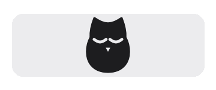

# World Science

[中文](README.md) · **English**

**A minimal proxy client for researchers.** Paste a subscription, press Connect, and the whole computer or phone can reach PubMed full text, Google Scholar, journal websites, conferences and research tools.

World Science is a free, open-source fork (GPL-3.0) of [v2rayN](https://github.com/2dust/v2rayN) for doctors, medical students and researchers using a proxy for the first time: no account, no complicated settings, only the few things you actually need.

<p align="center"></p>

## Why we built it

Many AI services are very sensitive to IP addresses. With load-balancing setups such as Clash, the exit node keeps hopping, which is unstable for your accounts: frequent IP changes can trigger risk checks and even bans, and even without a ban, once an AI service notices the changing IPs it tends to become unfriendly, for example with repeated CAPTCHAs.

## Our approach

Common clients such as v2rayN and Clash work on "more nodes, switch automatically". We recommend something different: **a subscription with a single fixed-IP node**. You only fill in one subscription link and it works, with the same exit IP every time, so day-to-day use is very stable. In the age of AI, we think this is an interesting and safer way to work.

## Who it is for

World Science is built on [v2rayN](https://github.com/2dust/v2rayN) and is made for beginners who have never used a proxy: fill in one subscription link and press Connect. If you already know v2rayN or Clash, you do not need it; the original apps are more flexible.

## Features

- **Any subscription**: standard subscription links from any provider (vmess / vless / trojan / shadowsocks / hysteria2 / tuic share links and their Base64 subscriptions); you can also paste node links directly.
- **One-tap global connection**: all traffic goes through the proxy by default (TUN on Mac / Windows, system VPN on Android), so browsers and desktop apps need no setup.
- **Automatic location**: latency and download speed are measured in the background, a working node is chosen automatically and replaced on failure; you can also pick a country or region by hand. With a single fixed-IP node in the subscription, the exit IP never changes.
- **The owl**: disconnected, it is daytime and the owl sleeps with its eyes shut; while connecting the sky turns to dusk and it half opens its eyes; connected, it is night, the moon rises and the owl's eyes light up.
- **Mac menu bar**: the owl sleeps when disconnected, opens its eyes when connected and beats its wings while traffic flows, faster with more traffic, still when nothing flows; live upload / download rates sit next to it. No animation when the system's "Reduce motion" is on.
- **Low maintenance**: launch at login, auto connect, detection of other proxy apps that would conflict, one-click diagnostics export (subscription addresses and IPs hidden), in-app updates (SHA-256 verified).
- **Chinese and English**: follows the system language, switchable in Settings.

## Download

| Platform | Package |
| --- | --- |
| Mac (Apple Silicon / Intel, macOS 13.6+) | `World-Science-<version>-macos-arm64.dmg` / `-macos-x64.dmg` |
| Windows 10/11 (x64 / ARM64) | `World-Science-<version>-windows-x64.zip` / `-windows-arm64.zip` |
| Android 8+ (ARM64 / x86_64) | `World-Science-<version>-android.apk` |

- GitHub: [Releases](https://github.com/robintheai/world-science/releases)
- Mirror: <https://ai.z5a.com/clients/world-science/> (for when GitHub is unreachable; identical files and checksums)

For a first install see the [installation guide](INSTALL.md) (Chinese). There is no iOS version yet (it needs Apple developer signing).

## Three steps

1. Open World Science, paste the subscription link from your provider under "Subscriptions" and tap "Add subscription".
2. Back on the home screen, keep "Automatic" or pick a region under "Choose location".
3. Press the round button in the middle to connect; press it again to disconnect.

World Science does not provide nodes. Availability, speed and data allowance depend on your subscription provider.

## Privacy

- No usage data is collected; no account system, no analytics or advertising SDKs.
- Subscription addresses are stored only on your device (Android uses the system's encrypted storage); logs and diagnostics contain no subscription addresses, node passwords or browsing history.
- The only network requests are: your subscription address, the node you choose, speed / connectivity test addresses, and update checks (the download mirror first, then GitHub).

## Build from source

Requires the .NET 10 SDK and Python 3; Mac packages also need the Xcode command line tools.

```bash
python3 scripts/build.py --rid osx-arm64 --version 1.0.0 --output dist
```

`--rid` can be `osx-arm64`, `osx-x64`, `win-x64` or `win-arm64`. The cores come from a pinned commit of [v2rayN-core-bin](https://github.com/2dust/v2rayN-core-bin) and are checked against SHA-256 during the build (see `scripts/core-checksums.json`).

Tests:

```bash
dotnet run --project tests/Simple.Smoke -c Release
```

```bash
WORLD_SCIENCE_DATA_DIR="$(mktemp -d)" ./build/osx-arm64/WorldScience --integration-test=test-results
```

For Android and the Go core see [mobile/README.md](mobile/README.md). Vector sources for the owl icons and the menu bar animation are in `assets/brand/owl/`.

## License and credits

GPL-3.0, see [LICENSE](LICENSE). Based on [2dust/v2rayN](https://github.com/2dust/v2rayN), with the cores [Xray-core](https://github.com/XTLS/Xray-core), [sing-box](https://github.com/SagerNet/sing-box) and [mihomo](https://github.com/MetaCubeX/mihomo); the full list is in [THIRD-PARTY.md](THIRD-PARTY.md).

This project is not an official v2rayN release and is not affiliated with any subscription provider. Please follow the laws and regulations where you live.
